<h1 align="center">안녕하세요, 박하스입니다 👋</h1>

  <b>모바일 &amp; 풀스택 엔지니어</b> · Mobile &amp; Fullstack Engineer 
  Flutter / Android · Spring Boot · React 
  📍 서울, 대한민국 · Seoul, South Korea

  
  
  
  
  
   
  
  
  
  
  

 

## 🔭 지금 하고 있는 것

> 미리보기를 누르면 사이트나 전체 화면(디자인 샘플)이 열립니다. APK는 공개 배포 저장소 [dock](https://github.com/parkhaas/dock)의 릴리스에서 받을 수 있습니다.

### 🌐 웹 페이지

<table>
  <tr>
    <td width="33%" valign="top">
      <a href="https://parkhaas.github.io/fp-pilot/">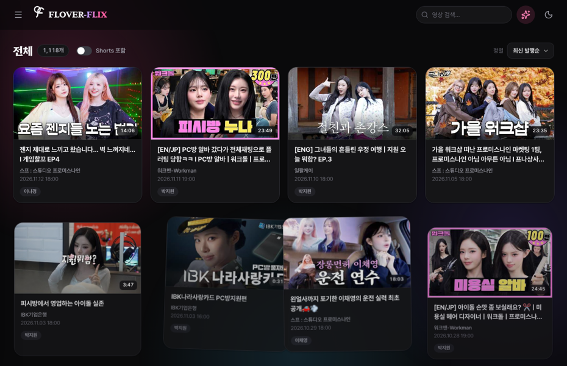</a> 
      <b>🎬 fp-pilot</b> · FLOVER-FLIX 
      Fromis9 팬 영상 아카이브. YouTube 영상 목록 자동 수집. 
      🔓 <a href="https://github.com/parkhaas/fp-pilot">저장소 공개</a> · <a href="https://parkhaas.github.io/fp-pilot/">사이트</a>
    </td>
    <td width="33%" valign="top">
      <a href="https://widget-eta-mocha.vercel.app/">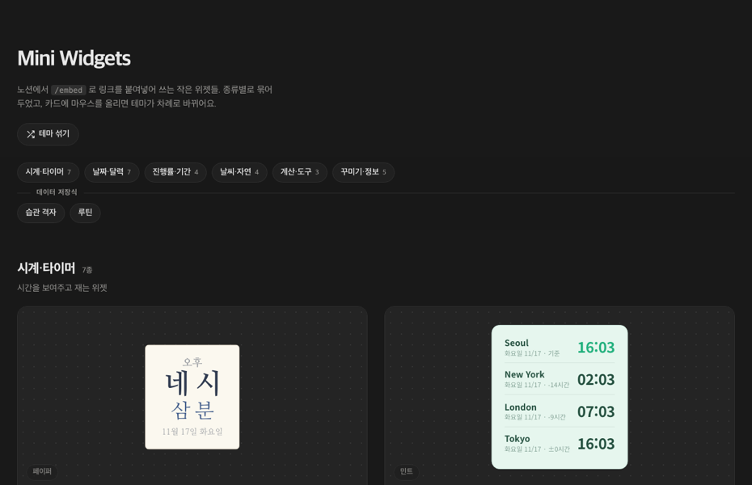</a> 
      <b>🧩 mini_widgets</b> · Mini Widgets 
      노션에 임베드해 쓰는 정적 미니 위젯 모음 (HTML/JS, 빌드 없음, Vercel 배포). 
      🔒 저장소 비공개 · <a href="https://widget-eta-mocha.vercel.app/">사이트</a>
    </td>
    <td width="33%" valign="top">
      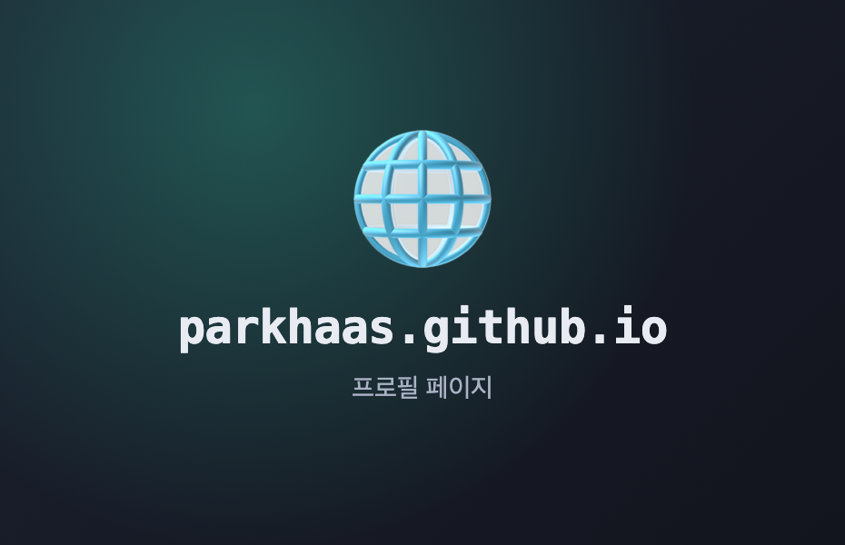 
      <b>🌐 parkhaas.github.io</b> · 프로필 페이지 
      박하스 프로필 페이지. 
      🔒 저장소 비공개
    </td>
  </tr>
  <tr>
    <td width="33%" valign="top">
      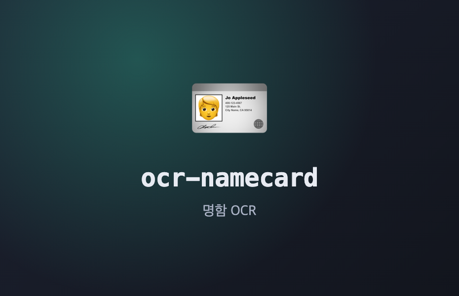 
      <b>🪪 ocr-namecard</b> · 명함 스캐너 
      명함 OCR 앱. 
      🔒 저장소 비공개
    </td>
    <td width="33%"></td>
    <td width="33%"></td>
  </tr>
</table>

### 📱 모바일 앱

<table>
  <tr>
    <td width="33%" valign="top">
      <a href="https://raw.githubusercontent.com/parkhaas/dock/main/docs/BudgetBook.png">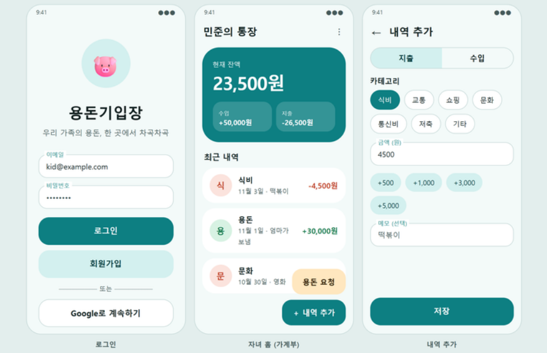</a> 
      <b>💰 BudgetBook</b> · 용돈기입장 
      태풍이 용돈 기입장. 자녀 앱은 기록·용돈 요청, 부모 앱은 용돈(정기 포함) 송금. 
      🔒 저장소 비공개 · <a href="https://github.com/parkhaas/dock/releases/tag/BudgetBook">APK</a> · <a href="https://github.com/parkhaas/dock/releases/tag/BudgetBookClient">Client APK</a>
    </td>
    <td width="33%" valign="top">
      <a href="https://raw.githubusercontent.com/parkhaas/dock/main/docs/RecordNoti.png">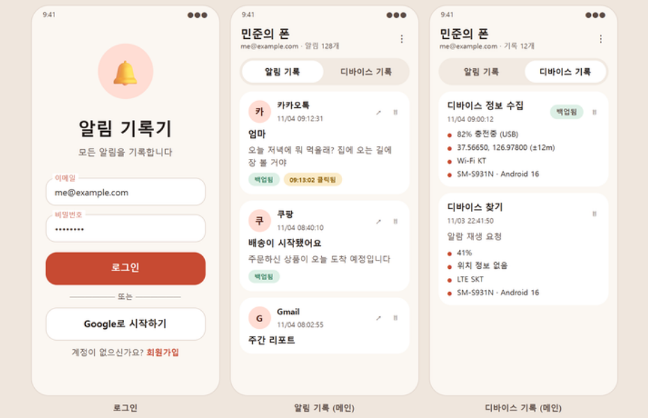</a> 
      <b>🔔 RecordNoti</b> · 알림 기록기 
      기기의 알림·상태를 기록하는 모니터 앱과 관리자 앱. 
      🔒 저장소 비공개 · <a href="https://github.com/parkhaas/dock/releases/tag/RecordNoti">APK</a>
    </td>
    <td width="33%" valign="top">
      <a href="https://raw.githubusercontent.com/parkhaas/dock/main/docs/familyguard.png">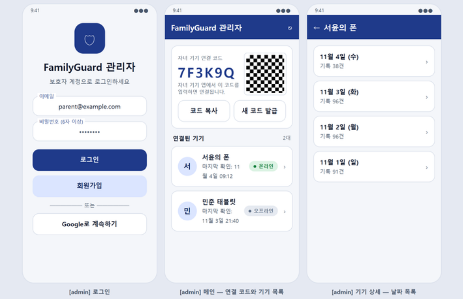</a> 
      <b>👨‍👩‍👧 familyguard</b> · FamilyGuard 
      자녀 기기 앱 사용 모니터링 앱. 
      🔒 저장소 비공개 · <a href="https://github.com/parkhaas/dock/releases/tag/familyguard">APK</a>
    </td>
  </tr>
  <tr>
    <td width="33%" valign="top">
      <a href="https://raw.githubusercontent.com/parkhaas/dock/main/docs/notion_cal.png">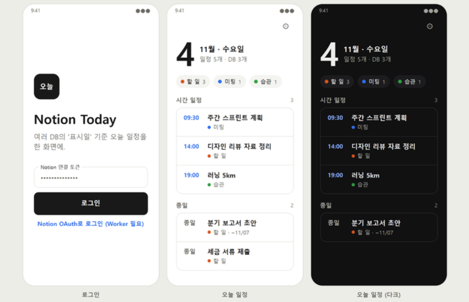</a> 
      <b>🗓️ notion_cal</b> · Notion Today 
      여러 Notion DB의 오늘 일정을 한 화면에 모아 보는 안드로이드 앱 (Kotlin/Compose). 
      🔒 저장소 비공개 · <a href="https://github.com/parkhaas/dock/releases/tag/notion_cal">APK</a>
    </td>
    <td width="33%" valign="top">
       
      <b>🎟️ codeManager</b> 
      바코드/QR을 열지 않고 읽고, 쿠폰을 보관·관리하는 Android 앱. 
      🔒 저장소 비공개 · <a href="https://github.com/parkhaas/dock/releases/tag/codeManager">APK</a>
    </td>
    <td width="33%" valign="top">
      <a href="https://raw.githubusercontent.com/parkhaas/dock/main/docs/photo-frame.png">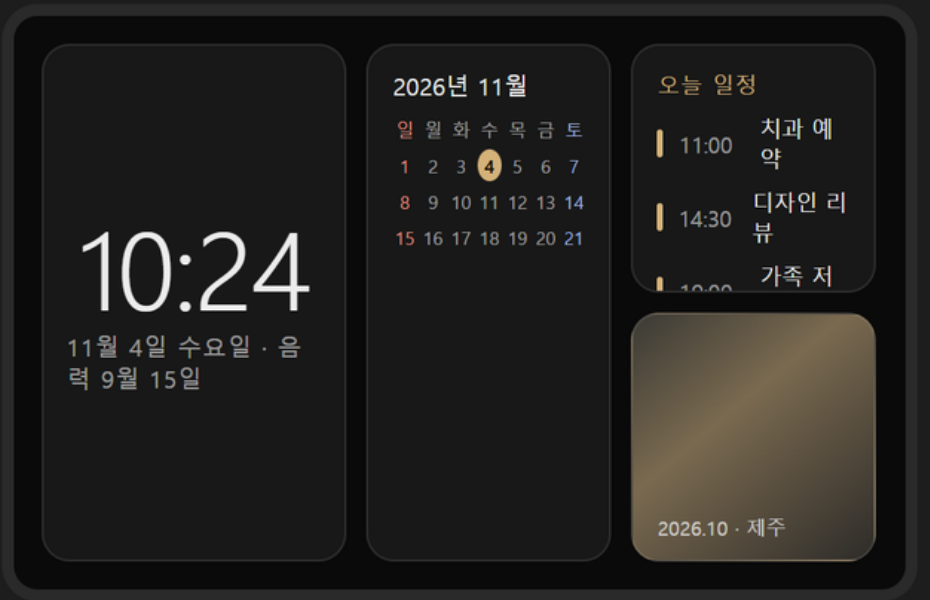</a> 
      <b>📷 photo-frame</b> · 전자액자 (PhotoFrame) 
      안드로이드 태블릿용 전자 액자 앱 (Kotlin/Compose). 
      🔒 저장소 비공개 · <a href="https://github.com/parkhaas/dock/releases/tag/photo-frame">APK</a>
    </td>
  </tr>
  <tr>
    <td width="33%" valign="top">
      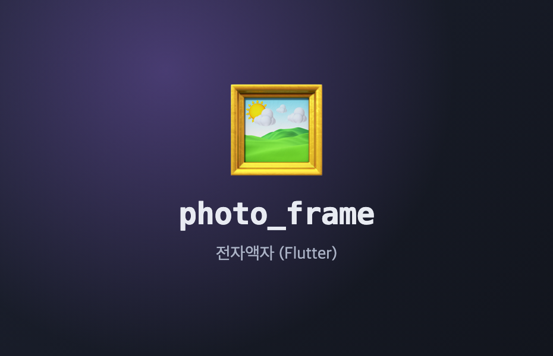 
      <b>🖼️ photo_frame</b> · 전자액자 (이전 버전) 
      전자액자 이전 버전 (Flutter 프로젝트). 
      🔒 저장소 비공개
    </td>
    <td width="33%" valign="top">
      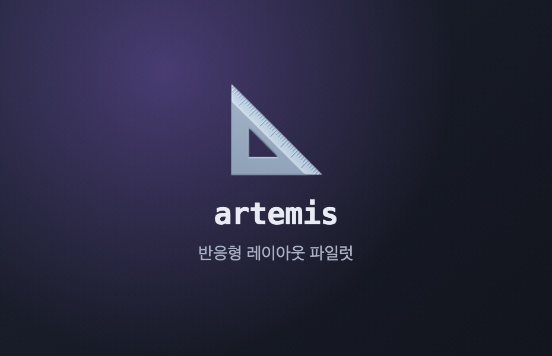 
      <b>📐 artemis</b> 
      다양한 스크린 사이즈(폰, 태블릿, PC 등)에 자동 대응하는 레이아웃 구성 파일럿 (Flutter). 
      🔒 저장소 비공개 · 업무 파일럿
    </td>
    <td width="33%"></td>
  </tr>
</table>

### 🛠️ 기타 툴

<table>
  <tr>
    <td width="33%" valign="top">
      <a href="https://github.com/parkhaas/dock">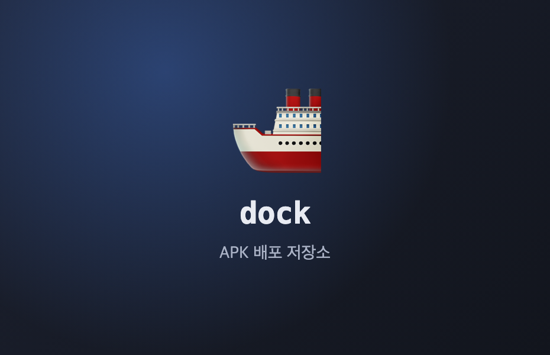</a> 
      <b>🚢 dock</b> 
      내 안드로이드 앱의 최신 APK를 올려 두는 공개 배포 저장소. 
      🔓 <a href="https://github.com/parkhaas/dock">저장소 공개</a>
    </td>
    <td width="33%" valign="top">
      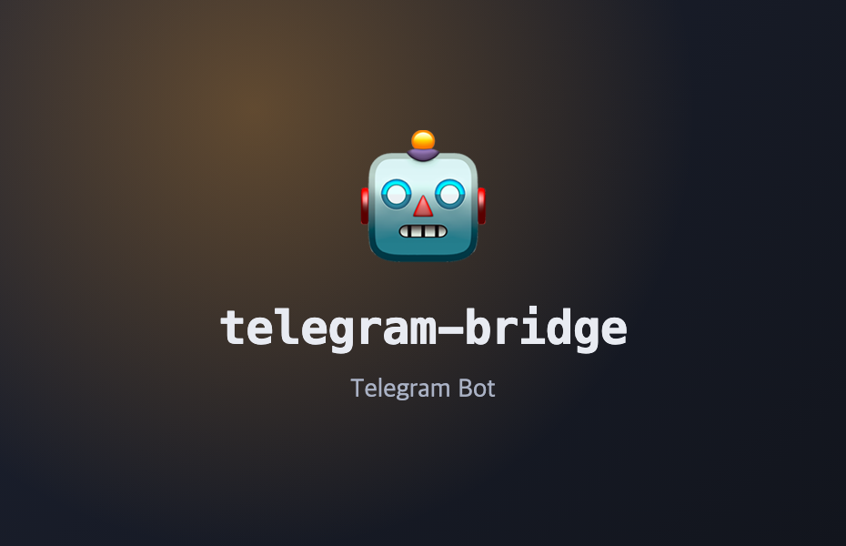 
      <b>🤖 telegram-bridge</b> 
      출퇴근 자동 브리핑과 Claude 대화를 중계하는 Telegram Bot. 
      🔒 저장소 비공개
    </td>
    <td width="33%" valign="top">
       
      <b>🗃️ wiki-archive</b> 
      웹 문서를 마크다운으로 연쇄 보관·갱신하고 링크가 살아 있는 HTML 사이트로 만드는 도구. 
      🔒 저장소 비공개
    </td>
  </tr>
  <tr>
    <td width="33%" valign="top">
      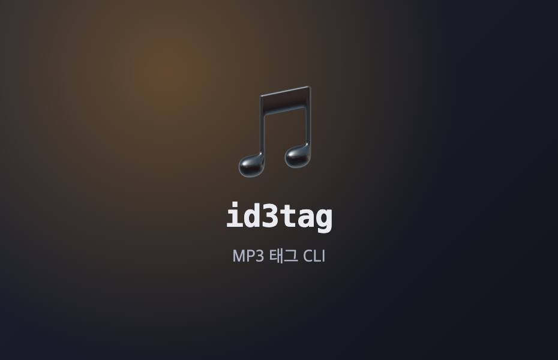 
      <b>🎵 id3tag</b> 
      MP3 ID3 태그 일괄 편집 CLI. 
      🔒 저장소 비공개
    </td>
    <td width="33%" valign="top">
       
      <b>📚 ParkhaasLib</b> 
      Android/Java 앱 구현간 공통코드 분리한 Library (본인 사용). 
      🔒 저장소 비공개
    </td>
    <td width="33%" valign="top">
       
      <b>🎞️ FrameSeeker</b> 
      영상처리를 위한 Frame 단위 전처리기 파일럿. 
      🔒 저장소 비공개 · 업무 파일럿
    </td>
  </tr>
  <tr>
    <td width="33%" valign="top">
       
      <b>🧪 CrayOnDemo</b> 
      CrazyOn 프로젝트 파일럿. 
      🔒 저장소 비공개 · 업무 파일럿
    </td>
    <td width="33%"></td>
    <td width="33%"></td>
  </tr>
</table>

 

## 📊 GitHub 통계

  <picture>
    <source media="(prefers-color-scheme: dark)" srcset="https://github-stats-extended.vercel.app/api?username=parkhaas&show_icons=true&theme=github_dark&hide_border=true&count_private=true&locale=kr" />
    
  </picture>
  <picture>
    <source media="(prefers-color-scheme: dark)" srcset="https://github-stats-extended.vercel.app/api/top-langs?username=parkhaas&layout=compact&theme=github_dark&hide_border=true&count_private=true" />
    
  </picture>

  <picture>
    <source media="(prefers-color-scheme: dark)" srcset="https://streak-stats.demolab.com/?user=parkhaas&theme=github-dark-blue&hide_border=true&locale=ko" />
    
  </picture>

 

## 🐍 컨트리뷰션 스네이크

  <picture>
    <source media="(prefers-color-scheme: dark)" srcset="https://raw.githubusercontent.com/parkhaas/parkhaas/output/github-contribution-grid-snake-dark.svg" />
    
  </picture>

